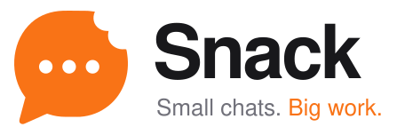

<p align="center">
  <picture>
    <source media="(prefers-color-scheme: dark)" srcset=".github/assets/snack-banner-dark.svg">
    
  </picture>
</p>

<p align="center">
  <strong>The self-hosted workspace for teams.</strong><br>
  Chat, huddles, projects, HR and an AI teammate in one Laravel app that runs on your own servers.
</p>

<p align="center">
  <a href="https://github.com/aynsdev/snack/actions/workflows/tests.yml"></a>
  <a href="LICENSE"></a>
  
  
  
</p>

<p align="center">
  <a href="#features">Features</a> ·
  <a href="#getting-started">Getting started</a> ·
  <a href="#configuration">Configuration</a> ·
  <a href="CONTRIBUTING.md">Contributing</a> ·
  <a href="SECURITY.md">Security</a>
</p>

---

## Features

- 💬 **Channels, DMs and threads** with mentions, reactions, saved items, file uploads and full-text search
- 🎧 **Huddles**: audio, video and screen sharing through a [LiveKit](https://livekit.io) server you host, so no third party carries your calls
- 📋 **Projects and canvases** for boards, tasks and shared documents
- 🗓️ **HR tools**: timesheets, time-change requests, holidays and an org chart
- ☀️ **Standups** that ask selected people in a channel and post the replies
- 🤖 **Bite**, an optional AI teammate that answers in channels and threads, follows up and updates tasks. It is off until you turn it on.
- 🔌 **Integrations**: incoming webhooks, an MCP server with OAuth, outside agent connectors, and a v1 mobile API with push notifications
- 🔒 **Invitation-first workspaces** with roles, an audit log, two-factor auth and presence

## Stack

| Layer | Tools |
| --- | --- |
| Backend | PHP 8.4, Laravel 13, Fortify, Passport, Sanctum |
| Frontend | React 19, Inertia v3, Tailwind CSS v4, Wayfinder |
| Realtime | Laravel Reverb, LiveKit for huddles |
| AI | Laravel AI SDK (Anthropic by default) |
| Database | PostgreSQL (full-text search, trigram matching and case-insensitive text) |

## Getting started

You need PHP 8.4, Composer, Node 22, npm and PostgreSQL. Create a database called `snack` for the app and one called `snack_testing` for the tests. `.env.example` connects as `postgres` with no password. If your setup is different, copy `.env.example` to `.env` and change the `DB_*` values before running `composer setup`.

```bash
git clone https://github.com/aynsdev/snack.git
cd snack
composer setup   # installs dependencies, creates .env, generates keys, migrates, builds assets
composer dev     # runs the queue workers and Vite
```

`composer dev` doesn't start a web server. Serve the app with [Laravel Herd](https://herd.laravel.com) or `php artisan serve`, and run `php artisan reverb:start` for realtime updates if `composer dev` doesn't start Reverb for you.

Public registration is off by default (`SNACK_ALLOW_PUBLIC_REGISTRATION=false`), so the first visit takes you through workspace setup. After that, people join through invitations.

### Huddles

Huddles need a LiveKit server. For local work, start the bundled one:

```bash
docker compose -f docker-compose.livekit.yml up -d
```

`livekit.yaml` is for laptops only. Its comments explain how to set up a production LiveKit host.

### Bite

Set `SNACK_BITE_ENABLED=true` and `ANTHROPIC_API_KEY` in `.env`. Bite sends workspace messages to your AI provider, so enable it on purpose.

## Configuration

Every setting lives in `.env.example`, and app behavior is in `config/snack.php`. Both are commented.

Before you share the public terms, privacy and account deletion pages (`/terms`, `/privacy`, `/delete-account`), set `SNACK_LEGAL_COMPANY`, `SNACK_LEGAL_COUNTRY` and `SNACK_LEGAL_CONTACT_EMAIL` to your own details, and review the policy text in `resources/js/pages/legal/` so it matches how you run Snack. Never commit `.env` or anything in `storage/*.key`.

## Testing

```bash
composer test       # Pint check, PHPStan, then Pest
composer ci:check   # every check: ESLint, Prettier, TypeScript, PHPStan, Pest (CI runs only Pest)
npm test            # Vitest frontend tests
```

## Contributing

See [CONTRIBUTING.md](CONTRIBUTING.md). Report security issues privately as described in [SECURITY.md](SECURITY.md), not in public issues.

## License

Snack is open-source software under the [MIT license](LICENSE).
